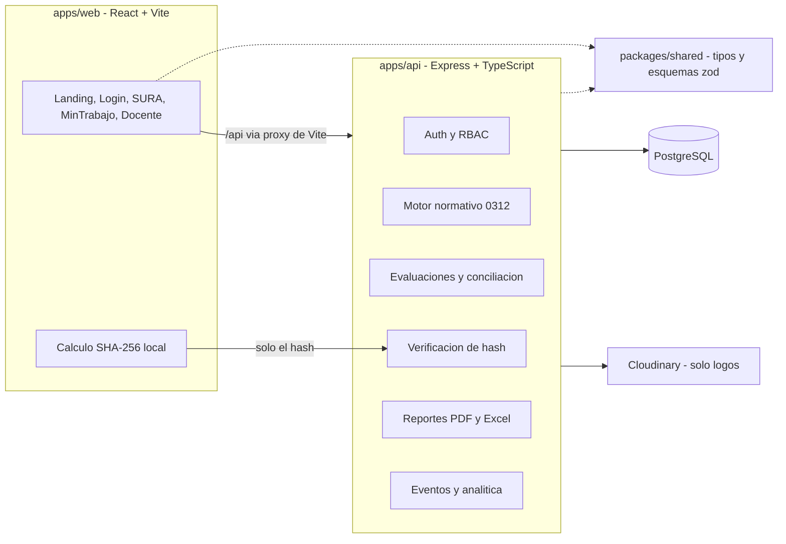

# PLAN.md — SimulSST Pro (v2)

Simulador web de Estándares Mínimos de SST (Resolución 0312 de 2019) con réplica de los portales de ARL SURA y Ministerio del Trabajo. Prototipo **local**, dividido en **frontend** y **backend**, con datos 100 % sintéticos.

> Esta versión reemplaza el borrador v1. Parte del prototipo real (`simulsst-pro.zip`, exportado de AI Studio), del SRS (RF00–RF20, RNF01–RNF05) y de las historias HU01–HU18.

## 0. Qué cambió respecto a v1

| Tema | v1 | v2 |
|---|---|---|
| Punto de partida | Construir el front desde cero (con shadcn/ui) | **Evolucionar el prototipo existente** (React 19 + Vite + Tailwind 4); no se reescribe la UI |
| Estructura | Carpetas `interfaces/`, `core/`, `skills/` del repo de agentes | **Monorepo con workspaces:** `apps/web`, `apps/api`, `packages/shared` |
| Base de datos | "Postgres o SQLite" sin decidir | **PostgreSQL** (base de datos relacional robusta con `pg` y Drizzle ORM); soporte completo para JSONB y concurrencia |
| Estándares y pesos | Mencionados, sin modelo | Tablas parametrizadas y *seed* (RNF02); todo cálculo **en el servidor** |
| Hash de evidencias | "Comparar contra catálogo" | El catálogo **nunca viaja al navegador**; solo se envía el hash y el servidor responde válido / vencido / trampa |
| Persistencia de borradores | Ambigua (RNF04 vs RF11) | Borrador en BD (JSON liviano) + espejo en `localStorage` |
| Cloudinary | Pieza central | **Opcional y acotada** a logos de empresas; si falta la configuración, la app arranca igual |
| Seguridad | RBAC en una línea | Contraseñas con hash, JWT en cookie `httpOnly`, validación con zod, control de propiedad por empresa, rate limiting |
| Secretos | Credenciales reales dentro del plan | Solo nombres de variables y `.env.example` |

## 1. Alcance

**Dentro del prototipo (SRS):** landing y selector (RF00), accesos por rol y carga por lote (RF01–RF05), módulo ARL (RF06–RF11), módulo MinTrabajo (RF12–RF16), logs, dashboard y exportación Excel del docente (RF17–RF20), alertas pedagógicas (RF19).

**Fuera de alcance salvo decisión expresa** (existen en el prototipo pero no en el SRS): "Generador de Simulacros", "Entregas por Revisar", temporizador de incidentes y botón de "Google Workspace" del login. El RF02 pide expresamente no depender del correo institucional, así que el botón de Google se elimina.

## 2. Hallazgos y riesgos

| # | Hallazgo | Severidad | Mitigación |
|---|---|---|---|
| R1 | Credenciales de Cloudinary escritas en el plan | Alta | Ya rotadas. Solo `.env` (ignorado por git) y `.env.example`. Agregar escaneo de secretos (gitleaks) como *pre-commit* |
| R2 | El prototipo no tiene backend ni autenticación real: el login solo navega | Alta | Fase 1–2: API con sesiones reales y guardas de ruta |
| R3 | Contraseña inicial = cédula (RF02) | Alta | Guardar solo el hash (bcrypt/argon2), exigir cambio en el primer ingreso, bloqueo temporal tras intentos fallidos |
| R4 | `crypto.subtle` (SHA-256) solo existe en contextos seguros: funciona en `localhost`, **no** en `http://192.168.x.x` | Alta | Demostrar siempre desde `localhost`, o usar HTTPS local (mkcert) o un *fallback* con `@noble/hashes` |
| R5 | Si el catálogo de hashes llega al cliente, el estudiante puede ver las respuestas | Alta | Endpoint `POST /api/evidence/verify`; el catálogo vive solo en el servidor |
| R6 | Un hash no dice si un documento está vigente | Media | El catálogo guarda metadatos: ítem, estado (`valido`, `vencido`, `trampa`), etiqueta y nota pedagógica |
| R7 | RNF04 ("almacenamiento en sesión/navegador") contradice RF11 (continuar en sesiones posteriores) | Media | Los borradores son filas JSON en BD; RNF04 se interpreta como "no guardar archivos" |
| R8 | La conciliación SURA ↔ MinTrabajo en el cliente se puede manipular | Media | Calificación, porcentajes y conciliación se calculan y validan solo en el servidor |
| R9 | HU05 dice "10, 21 o 60" estándares; la norma y los criterios dicen 7, 21 o 60 | Media | Corregir la historia; el motor usa 7/21/60 |
| R10 | HU07 admite SHA-256 **o** MD5 | Media | Usar solo SHA-256; MD5 está roto |
| R11 | El prototipo acepta `.docx` y `.xlsx` como evidencia; el SRS habla de PDF | Baja | Aceptar solo `.pdf` y validar también la firma `%PDF-`; tope de tamaño |
| R12 | Faltan: login ARL estudiante, campo de observaciones (RF10), carga masiva (RF02), logs (RF17), exportación `.xlsx` (RF20) | Media | Cubiertos en las fases 3–6 |
| R13 | Pantallas de 1.000+ líneas y navegación por `useState`: sin URLs, sin botón "atrás", sin enlaces directos | Media | `react-router` + componentes por *feature* |
| R14 | `bun.lock` vacío (0 bytes) y dependencias sin uso (`@google/genai`, `express`, `dotenv` en el front); versiones generadas por AI Studio | Baja | Usar npm; limpiar dependencias; verificar que `npm install` resuelva sin conflictos |
| R15 | Pesos guardados como texto ("Peso: 4.0 %") y datos fijos en el código | Media | Columnas numéricas en BD y *seed* desde la tabla oficial |
| R16 | La biblioteca `xlsx` de npm (SheetJS) está desactualizada y con vulnerabilidades conocidas | Media | Usar `exceljs` en el servidor |
| R17 | Alcance que crece: módulos del prototipo que el SRS no pide | Media | Sección 1: se aplazan hasta cerrar las fases 1–6 |
| R18 | Contraste: #FFC107 y #00A3E0 no sirven como color de texto sobre blanco | Baja | Usarlos como relleno, insignias o íconos; texto en #005EB8 o neutros |

## 3. Arquitectura

### 3.1 Vista general



### 3.2 Estructura del repositorio

```text
simulsst-pro/
├─ apps/
│  ├─ web/                       # frontend (el prototipo actual migra aquí)
│  │  ├─ public/brand/           # logo recortado + favicon
│  │  └─ src/
│  │     ├─ app/                 # router, layouts, guardas de ruta, providers
│  │     ├─ features/
│  │     │  ├─ landing/
│  │     │  ├─ auth/             # login (3 identidades), recuperación, cambio de clave
│  │     │  ├─ sura/             # configuración, autoevaluación, evidencias
│  │     │  ├─ mintrabajo/       # inscripción, responsable, conciliación, reporte
│  │     │  ├─ plan-mejoramiento/
│  │     │  └─ docente/          # dashboard, empresas, usuarios, catálogo de hashes
│  │     ├─ shared/              # ui (Button, Modal, Toast...), api client, hooks, lib/hash.ts
│  │     └─ theme/tokens.css     # paleta y temas por portal
│  └─ api/
│     ├─ src/
│     │  ├─ config/              # env.ts (zod), cloudinary.ts, logger
│     │  ├─ db/                  # schema, migraciones, seed
│     │  ├─ modules/             # auth, users, companies, evaluations, evidence,
│     │  │                       # mintrabajo, plan, docente, events, uploads
│     │  ├─ core/normative/      # motor 0312 (funciones puras)
│     │  ├─ core/validators/     # vigencias, conciliación
│     │  ├─ core/reports/        # PDF y Excel
│     │  └─ middleware/          # auth, rbac, ownership, rate-limit, errores
│     └─ .env.example
├─ packages/shared/              # tipos, enums y esquemas zod compartidos
├─ docs/                         # SRS, historias, ADRs
├─ package.json                  # npm workspaces + scripts raíz
└─ .gitignore                    # .env*, *.sqlite, node_modules, dist
```

### 3.3 Stack

| Capa | Tecnología | Justificación / cambio frente a v1 |
|---|---|---|
| Frontend | React + TypeScript + Vite + Tailwind 4 + `react-router` | Ya está en el prototipo. Se descarta shadcn/ui: reescribir la UI no aporta. Se conserva `motion` solo para transiciones de página |
| Formularios | `react-hook-form` + `zod` (esquemas de `packages/shared`) | Mismas reglas en cliente y servidor |
| Backend | Node + Express + TypeScript | Lo más simple para una API REST local |
| BD / ORM | PostgreSQL (`pg`) + Drizzle ORM (`drizzle-orm`, `drizzle-kit`) | Base de datos relacional robusta, soporte para JSONB nativo, tipado estricto y migraciones |
| Auth | `bcryptjs` o `argon2`, JWT en cookie `httpOnly` + `SameSite=Lax` | Con el proxy de Vite el origen es único: sin CORS ni CSRF complejos |
| Seguridad HTTP | `helmet`, `express-rate-limit` | Mínimo razonable aun en local |
| PDF | `pdfkit` en el servidor | Sin navegador *headless*; los datos del certificado salen del servidor |
| Excel | `exceljs` en el servidor | Evita la dependencia vulnerable de SheetJS |
| Hash | Web Crypto (`crypto.subtle.digest`) + *fallback* `@noble/hashes` | Ver riesgo R4 |
| Imágenes | Cloudinary (opcional) | Sección 8 |
| Pruebas | `vitest` (motor, validadores) + `supertest` (API) | Las reglas críticas son funciones puras |
| Orquestación local | `concurrently` | Un solo `npm run dev` levanta API y web |

## 4. Modelo de datos (PostgreSQL + Drizzle ORM)

| Tabla | Campos clave | Notas |
|---|---|---|
| `users` | id, email (único), password_hash, role (`estudiante`/`docente`), must_change_password, group_id, active | Carga por CSV (RF02) |
| `groups` | id, name, term | Para filtros del dashboard |
| `companies` | id, nit, razon_social, regimen, representante_legal, sede, ciiu, num_trabajadores, riesgo, logo_public_id | Catálogo del docente (RF03) |
| `company_assignments` | company_id, user_id, status (`activo`/`inactivo`/`desvinculado`), started_at, ended_at | Historial conservado (RF05, HU04) |
| `standards` | code, phva, name, criteria, verification_mode, weight (numérico) | Parametrizable (RNF02) |
| `standard_groups` | standard_code, group (`7`/`21`/`60`), weight_override | Aplicabilidad por tipo de empresa |
| `evaluations` | id, company_id, user_id, attempt, config_json (centro, riesgo, trabajadores, agropecuaria), standards_group, status (`borrador`/`enviada`), started_at, submitted_at | Un intento nuevo siempre inicia vacío (RF07) |
| `evaluation_items` | evaluation_id, standard_code, value (`cumple`/`no_cumple`/`no_aplica`), observation, evidence_status, evidence_sha256, updated_at | Observación obligatoria (RF10) |
| `evidence_catalog` | id, standard_code, sha256 (único), status (`valido`/`vencido`/`trampa`), label, note | Cargado por el docente |
| `responsables_sst` | user_id, company_id, licencia, resolucion, entidad, experiencia_meses, curso50_fecha, curso20_fecha | Vigencias validadas en servidor |
| `mintrabajo_submissions` | evaluation_id, company_data_json, scores_json, reconciled, submitted_at | Resultado de la conciliación |
| `improvement_plan_items` | evaluation_id, standard_code, actividad, responsable, meta, plazo_dias, estado | Obligatorio si el puntaje < 100 % |
| `event_logs` | id, user_id, evaluation_id, type, route, payload_json, duration_ms, created_at | Registro silencioso (RF17) |
| `settings` | key, value | Parámetros: años de vigencia del curso de 50 h, umbrales de calificación, tope de tamaño de PDF |
| `password_resets` | user_id, token_hash, expires_at, used_at | Recuperación simulada (RF04) |

Reglas: claves foráneas activas, `UNIQUE (evaluation_id, standard_code)` en `evaluation_items`, y toda consulta de un estudiante filtrada por empresas asignadas (evita acceso a datos ajenos).

## 5. API REST (`/api`)

| Módulo | Endpoints | Rol | Requisitos |
|---|---|---|---|
| Salud | `GET /health` | público | — |
| Auth | `POST /auth/login`, `POST /auth/logout`, `GET /auth/me`, `POST /auth/change-password` | todos | RF01, RF02 |
| Recuperación | `POST /auth/forgot-password`, `POST /auth/reset-password` | público | RF04, HU03 |
| Usuarios | `POST /users/import` (CSV), `GET /users`, `PATCH /users/:id` | docente | RF02 |
| Empresas | `GET/POST/PATCH /companies`, `GET /companies/mine`, `POST /companies/:id/assign`, `POST /companies/:id/responsable/deactivate` | docente / estudiante (solo `mine`) | RF03, RF05 |
| Normativa | `POST /normative/classify` → `{ grupo: 7 \| 21 \| 60, fases }`, `GET /standards?evaluationId=` | estudiante | RF06, RF08 |
| Evaluaciones | `POST /evaluations`, `GET /evaluations/:id`, `PUT /evaluations/:id/items/:code` (autoguardado), `POST /evaluations/:id/submit` | estudiante | RF07–RF11 |
| Evidencias | `POST /evidence/verify` `{ evaluationId, itemCode, sha256, size }` | estudiante | RF09 |
| Catálogo de hashes | `GET/POST/DELETE /evidence-catalog`, `POST /evidence-catalog/import` | docente | RF09 |
| MinTrabajo | `PUT /mintrabajo/:evalId/company`, `PUT /mintrabajo/:evalId/responsable`, `POST /mintrabajo/:evalId/reconcile`, `GET /mintrabajo/:evalId/report.pdf` | estudiante | RF12–RF15 |
| Plan de mejoramiento | `GET/PUT /evaluations/:id/plan`, `GET /evaluations/:id/plan.pdf`, `GET /evaluations/:id/plan.xlsx` | estudiante | RF16 |
| Docente | `GET /docente/metrics`, `GET /docente/students/:id/trace`, `GET /docente/export.xlsx` | docente | RF18, RF20 |
| Eventos | `POST /events` (lotes) | autenticado | RF17 |
| Subidas | `POST /uploads/company-logo` | docente | Sección 8 |

Convenciones: validación con zod en cada entrada, errores en formato `{ code, message, pedagogical? }` (el campo `pedagogical` alimenta los pop-ups de RF19), y respuestas sin campos sensibles.

## 6. Reglas de negocio críticas

### 6.1 Motor normativo (`core/normative`)

Funciones puras, sin acceso a BD ni a `Date.now()`, para poder probarlas bien.

| Condición | Estándares |
|---|---|
| ≤ 10 trabajadores y riesgo I, II o III | **7** (Planear y Hacer) |
| 11 a 50 trabajadores y riesgo I, II o III | **21** |
| > 50 trabajadores **o** riesgo IV o V (cualquier tamaño) | **60** (PHVA completo) |

- Unidades agropecuarias: el SRS las menciona sin cifra. **Verificar contra el texto oficial** antes de codificar la regla.
- Pesos, textos y criterios provienen de las tablas `standards` y `standard_groups`, cargadas por *seed* desde la tabla oficial y editables por el docente (RNF02, HU17).
- Puntaje por fase PHVA y total: suma de pesos de ítems `cumple`. Tratamiento de `no_aplica` y umbrales de calificación (crítico / moderadamente aceptable / aceptable): **parámetros en `settings`, a verificar con la resolución**.
- Incongruencias entre riesgo/tamaño y estándares elegidos devuelven un error pedagógico (RF19).

### 6.2 Evidencias por hash

1. El navegador lee el PDF localmente y calcula SHA-256 (`shared/lib/hash.ts`); el archivo no se envía.
2. Se valida antes: extensión `.pdf`, firma `%PDF-` y tamaño máximo (parámetro).
3. `POST /evidence/verify` recibe `sha256` e ítem y responde `valido`, `vencido` o `trampa` (hash no catalogado = documento erróneo), con la nota pedagógica.
4. Se guardan solo `evidence_status` y `evidence_sha256` por ítem; cada intento fallido genera un evento de log.
5. **Herramienta para el docente:** en el catálogo, un selector local de PDF calcula el hash en el navegador y lo registra con su estado, para no copiarlo a mano.

### 6.3 Vigencias del responsable SST

- El servidor evalúa: curso de 50 h vigente si `hoy ≤ fecha + N años` (N = 3, en `settings`); si venció, se exige actualización de 20 h posterior.
- Si no cumple, la API responde bloqueo con mensaje pedagógico y el front abre el modal de RF13. El "hoy" se inyecta para poder probar con fechas fijas.

### 6.4 Conciliación SURA ↔ MinTrabajo

- MinTrabajo solo se habilita con una evaluación ARL en estado `enviada`.
- El estudiante digita los puntajes en MinTrabajo; `POST /reconcile` los compara ítem por ítem con la evaluación ARL. Si hay diferencias, devuelve cuáles y no avanza (RF14).
- Con conciliación exitosa se calculan los porcentajes PHVA y se habilita el certificado PDF (RF15).

### 6.5 Plan de mejoramiento

Se activa si el puntaje total < 100 % o hay ítems `no_cumple`; la matriz se pre-llena con esos ítems. Exportación a PDF (`pdfkit`) y Excel (`exceljs`).

### 6.6 Borradores y logs

- Autoguardado con *debounce* (≈ 1 s) hacia `PUT /items/:code`, más espejo en `localStorage` para no perder el último cambio.
- Eventos en cola en el cliente y envío por lotes con `navigator.sendBeacon` / `fetch keepalive`: tiempo por sección, cambios de respuesta, intentos de hash fallidos y uso de "No aplica". Nunca bloquean la interfaz.

## 7. Frontend

### 7.1 Rutas

| Ruta | Pantalla | Rol |
|---|---|---|
| `/` | Landing y selector (SURA / MinTrabajo / Docente) | público |
| `/login/sura`, `/login/mintrabajo`, `/login/docente` | Logins con la identidad de cada portal | público |
| `/recuperar` | Recuperación simulada | público |
| `/estudiante/empresas` | Selección de empresa | estudiante |
| `/sura/configuracion`, `/sura/evaluacion` | Clasificación y autoevaluación | estudiante |
| `/mintrabajo/inscripcion`, `/responsable`, `/conciliacion`, `/reporte`, `/plan-mejoramiento` | Módulo MinTrabajo (las 6 pestañas del prototipo pasan a rutas) | estudiante |
| `/docente/dashboard`, `/empresas`, `/usuarios`, `/evidencias-hash`, `/trazabilidad` | Panel docente | docente |

Guardas de ruta por rol y redirección al login del portal correspondiente (RF00).

### 7.2 Identidad visual (logo y paleta)

Tokens en `theme/tokens.css` con `@theme` de Tailwind 4, y un atributo `data-theme` por portal (`plataforma`, `sura`, `mintrabajo`) para conservar la identidad diferenciada que pide RNF01:

| Token | Valor | Uso |
|---|---|---|
| `--color-brand-900` | `#005EB8` | Primario, botones, encabezados |
| `--color-brand-600` | `#007BFF` | Enlaces, estados activos |
| `--color-brand-400` | `#00A3E0` | Acentos, fondos suaves |
| `--color-success` | `#28A745` | Cumple, válido |
| `--color-warning` | `#FFC107` | Pendiente, alerta (solo como relleno) |
| `--color-danger` | `#DC3545` | No cumple, bloqueo |

- El PNG del logo trae las muestras de color y los códigos dentro de la imagen: hace falta una versión **recortada, con fondo transparente** (idealmente SVG) en `public/brand/`, más favicon.
- Reemplazar en el prototipo las clases por defecto (`blue-600`, `blue-900`, `emerald-600`) por los tokens.
- Definir la animación `slideUp` que usa el *toast* (hoy no existe en Tailwind 4 y no se aplica).

### 7.3 Migración del prototipo

1. Mover el código a `apps/web` y dividir los 5 componentes grandes en `features/*`.
2. Extraer a `shared/ui` los patrones repetidos: botón, modal, *toast*, insignia, tarjeta, tabla.
3. Sustituir cada dato fijo (`useState` con valores de ejemplo) por una consulta a la API.
4. Eliminar lo que está fuera de alcance (Google, simulacros) o moverlo a una rama aparte.

## 8. Cloudinary (optimizado)

**Alcance real:** como los PDF no se almacenan (RNF04), Cloudinary solo sirve para **logos de empresas** cargados por el docente. Se trata como un servicio opcional.

| Decisión | Detalle |
|---|---|
| Configuración | `apps/api/src/config/env.ts` valida con zod. Si falta alguna de las 3 variables, la API arranca igual, `POST /uploads/company-logo` responde 503 y el front muestra un avatar con las iniciales de la empresa |
| Secretos | `CLOUDINARY_CLOUD_NAME`, `CLOUDINARY_API_KEY`, `CLOUDINARY_API_SECRET` solo en `apps/api/.env`. El front solo necesita el *cloud name* público (`VITE_CLOUDINARY_CLOUD_NAME`); **ninguna variable `VITE_` con el secreto** |
| Subida | `multer` con `memoryStorage`, límite de 2 MB, un solo archivo; envío con `cloudinary.uploader.upload_stream` |
| Tipos permitidos | `jpg`, `png`, `webp`. **Se quita SVG** (puede incluir scripts). Validar la firma real del archivo (*magic bytes*), no solo el MIME declarado |
| Opciones de subida | `folder: "sst-simulador/empresas"`, `resource_type: "image"`, `allowed_formats`, `overwrite: true` con `public_id` estable por empresa |
| Qué se guarda en BD | Solo `logo_public_id` (no la URL completa); la URL se arma al mostrar |
| Renderizado | Transformaciones en la URL: `f_auto,q_auto,c_fill,w_200,h_200`. Sin *cloud name* configurado, se usa el avatar de iniciales |
| Permisos | Solo rol `docente`, con *rate limit* |
| Reemplazo / borrado | Al cambiar el logo se sobrescribe el mismo `public_id`; al borrar la empresa se llama a `destroy` |

Alternativa **no** adoptada: subida firmada directa desde el navegador. Es más eficiente a escala, pero añade un endpoint de firma y complejidad que un prototipo local no necesita.

## 9. Seguridad y ejecución local

### 9.1 Variables de entorno

| Archivo | Variables |
|---|---|
| `apps/api/.env` | `PORT`, `NODE_ENV`, `DATABASE_URL`, `JWT_SECRET`, `COOKIE_SECURE`, `CLOUDINARY_CLOUD_NAME`, `CLOUDINARY_API_KEY`, `CLOUDINARY_API_SECRET` |
| `apps/web/.env` | `VITE_CLOUDINARY_CLOUD_NAME` (opcional) |
| `*.env.example` | Mismos nombres con valores vacíos; son los únicos que se versionan |

### 9.2 Medidas mínimas

- Contraseñas con hash y cambio obligatorio en el primer ingreso; mensajes de login genéricos.
- Cookie `httpOnly`, `SameSite=Lax`, expiración corta; `helmet`; *rate limit* en login, `forgot-password` y `evidence/verify`.
- Token de recuperación guardado como hash, con vencimiento de 15 min; el "correo" se muestra en una bandeja simulada de la interfaz (sin SMTP).
- Middleware de propiedad: un estudiante solo ve empresas y evaluaciones propias.
- CSV de carga masiva: tope de tamaño y de filas, validación de formato, sin ejecutar contenido.
- `npm audit` y gitleaks antes de entregar.

### 9.3 Scripts (raíz)

| Script | Acción |
|---|---|
| `npm run setup` | Instala dependencias y crea los `.env` a partir de los `.example` |
| `npm run db:migrate` / `npm run db:seed` | Crea el esquema y carga datos sintéticos (1 docente, estudiantes, empresas, estándares, catálogo de hashes de ejemplo) |
| `npm run dev` | API en `:4000` y web en `:3000` (proxy `/api` → `:4000`) |
| `npm run test` / `npm run lint` | Pruebas y tipos en ambos paquetes |

## 10. Fases y tareas

| Fase | Entregable | Tareas principales | Requisitos |
|---|---|---|---|
| **0. Base** | Monorepo corriendo | Workspaces, tsconfig, ESLint/Prettier, limpieza del prototipo (R14), `.env.example`, gitleaks, logo recortado | R1, R14 |
| **1. Backend base** | API con BD y seed | Express + TS, `env.ts`, esquema y migraciones, seed de estándares, errores y logger, `/health` | RNF02, RNF03 |
| **2. Auth y empresas** | Login real + catálogo | Login/logout/`me`, cambio de clave, recuperación simulada, carga CSV, CRUD de empresas, asignación y desvinculación, guardas en el front, router | RF01–RF05 |
| **3. Módulo ARL** | Autoevaluación completa | Motor normativo con pruebas, configuración de centro/riesgo, formulario con observaciones obligatorias, hash en cliente + verificación, autoguardado, login ARL | RF06–RF11, RF19 |
| **4. MinTrabajo** | Flujo hasta el PDF | Inscripción, responsable con vigencias y modal de bloqueo, conciliación, porcentajes PHVA, certificado PDF | RF12–RF15 |
| **5. Plan de mejoramiento** | Matriz obligatoria | Activación por puntaje, matriz editable, exportación PDF/Excel | RF16 |
| **6. Docente y analítica** | Panel funcional | Eventos por lotes, dashboard (tiempos, fallas por estándar, errores de hash), catálogo con selector de hash, filtros, exportación `.xlsx` | RF17, RF18, RF20 |
| **7. Cloudinary y pulido** | Logos + QA | Subida y avatar de respaldo, tokens de color en toda la UI, accesibilidad (contraste, foco, teclado), README de uso local | RNF01 |

Orden recomendado: 0 → 1 → 2 → 3 (el módulo más grande y el que valida la arquitectura) → 4 → 5 → 6 → 7. Las fases 6 y 7 pueden solaparse.

## 11. Pruebas y criterios de aceptación

| Área | Pruebas |
|---|---|
| Motor normativo | Tabla de casos (tamaño × riesgo × agropecuaria) → 7/21/60; cálculo de porcentajes PHVA |
| Hash | PDF válido, vencido, trampa, archivo modificado (1 byte), no PDF, archivo sobre el tope |
| Vigencias | Curso vigente, vencido sin actualización (bloquea), vencido con actualización (pasa), con fecha inyectada |
| Conciliación | Coincide, un ítem distinto, evaluación no enviada |
| Autoguardado | Cerrar y reabrir retoma el último ítem; intento nuevo inicia vacío |
| Seguridad | Estudiante A no accede a la evaluación de B; rutas de docente vetadas a estudiantes; clave inicial no queda en texto plano |
| Cloudinary | Sin variables la app arranca y muestra iniciales; archivo SVG o falso `.png` rechazado |

**Checklist final**

- [ ] Ninguna credencial en el repositorio ni en el historial
- [ ] El secreto de Cloudinary nunca llega al navegador
- [ ] El catálogo de hashes nunca llega al navegador y el PDF nunca se sube
- [ ] Puntajes y conciliación calculados solo en el servidor
- [ ] Motor correcto para 7, 21 y 60 estándares
- [ ] Bloqueo por vigencia (50 h / 20 h) funcionando
- [ ] Plan de mejoramiento obligatorio con puntaje < 100 %
- [ ] Observación obligatoria en cada ítem
- [ ] Logs registrados sin afectar la interfaz
- [ ] PDF y Excel descargables
- [ ] Interfaz con la paleta y el logo de SimulSST Pro, y las 3 identidades de portal
- [ ] `npm run setup && npm run db:seed && npm run dev` funciona en una máquina limpia
- [ ] Datos 100 % sintéticos

## 12. Supuestos y decisiones pendientes

1. **Paleta:** se asume que #005EB8, #007BFF, #00A3E0, #28A745 y #FFC107 son la marca de la plataforma (landing y docente), y que SURA y MinTrabajo conservan una variante propia por portal. Confirmar.
2. **Texto oficial de la Res. 0312:** unidades agropecuarias, pesos por ítem, tratamiento de "No aplica" y umbrales de calificación deben contrastarse con la resolución antes de cargar el *seed*.
3. **Intentos:** se asume varios intentos por empresa y estudiante, cada uno desde cero (RF07), con historial.
4. **Alcance del catálogo de hashes:** se asume uno por ítem y válido para todas las empresas; si cada empresa simulada necesita sus propios documentos, se agrega `company_id`.
5. **Módulos del prototipo fuera del SRS** (simulacros, entregas por revisar): aplazados.
6. **HU05 y HU07:** corregir "10" por "7" y retirar MD5 en la documentación.
7. **Idioma:** interfaz y datos en español; código y commits en inglés.

## 13. Referencias

- `docs/requerimientos.md` — SRS (RF00–RF20, RNF01–RNF05)
- `docs/historias_user.md` — HU01–HU18
- Prototipo `simulsst-pro.zip` y proyecto Stitch "Simulador Académico SST Pro" (ID 11743137579217586199)
- Resolución 0312 de 2019 — texto oficial, para contrastar el *seed* normativo
