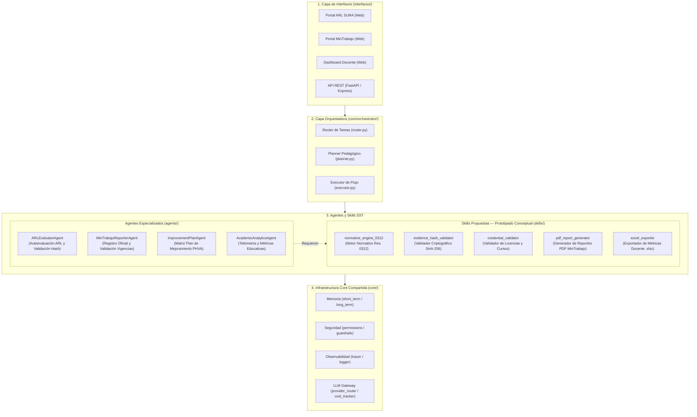

# Arquitectura del Sistema — Simulador SST

Este documento describe la arquitectura modular y en capas del **Simulador de Seguridad y Salud en el Trabajo (SG-SST - Resolución 0312 de 2019)**, construido sobre un framework desacoplado de Agentes y Skills.

---

## 🏛️ Diagrama General en Capas

---

## 🧩 Descripción Detallada de Capas

### 1. Capa de Interfaces (`interfaces/`)
- **Portal ARL SURA (`interfaces/web/sura/`):** Réplica visual e interactiva para la autoevaluación inicial del estándar, captura de evidencias con cálculo de Hash cliente y justificación técnica de criterios.
- **Portal MinTrabajo (`interfaces/web/mintrabajo/`):** Réplica del reporte oficial, registro del responsable de SST, conciliación de puntajes directos y visualización del Plan de Mejoramiento.
- **Dashboard Docente (`interfaces/web/docente/`):** Visualización de métricas de aprendizaje, asignación de empresas simuladas por NIT/catálogo y descarga de reportes.
- **API Backend (`interfaces/api/`):** Endpoints REST para autenticación simplificada por lote, control de flujo y consulta normativa.

### 2. Capa Orquestadora (`core/orchestrator/`)
- **Router (`router.py`):** Clasifica la intención y fase de la práctica del estudiante para dirigir el evento al agente correspondiente.
- **Planner (`planner.py`):** Gestiona la secuencia pedagógica del flujo:
  1. *Fase 1:* Diagnóstico y autoevaluación ARL SURA (`arl_evaluator_agent`).
  2. *Fase 2:* Registro del responsable y reporte MinTrabajo (`mintrabajo_reporter_agent`).
  3. *Fase 3:* Formulación y seguimiento del Plan de Mejoramiento (`improvement_plan_agent`).
  4. *Monitoreo continuo:* Trazabilidad formativa (`academic_analytics_agent`).
- **Executor (`executor.py`):** Ejecuta las cadenas de tareas y llamadas a skills de forma segura, con manejo de fallbacks y reintentos.

### 3. Capa de Agentes Especializados (`agents/`)

Los agentes encapsulan el razonamiento, contexto de sesión y orquestación de reglas de negocio para cada fase del simulador:

| Agente | Módulo / Clase | Responsabilidad Principal | Skills Requeridas |
| :--- | :--- | :--- | :--- |
| **`arl_evaluator_agent`** | [`ARLEvaluatorAgent`](file:///c:/Users/Natali/OneDrive/Documentos/Universidad/Proyecto%20SST/Simulador/agents/arl_evaluator_agent/agent.py) | Simula la autoevaluación de estándares mínimos en el portal ARL (SURA). Valida la clasificación según tamaño/riesgo de la empresa, coteja evidencias mediante huella digital (hash) y evalúa justificaciones en respuestas "No Aplica". | `normative_engine_0312`, `evidence_hash_validator` |
| **`mintrabajo_reporter_agent`** | [`MinTrabajoReporterAgent`](file:///c:/Users/Natali/OneDrive/Documentos/Universidad/Proyecto%20SST/Simulador/agents/mintrabajo_reporter_agent/agent.py) | Simula el registro formal ante el Ministerio del Trabajo. Valida la vigencia de la licencia SST y certificaciones de cursos (50h / 20h), concilia calificaciones cuantitativas y genera el reporte consolidado oficial. | `credential_validator`, `pdf_report_generator` |
| **`improvement_plan_agent`** | [`ImprovementPlanAgent`](file:///c:/Users/Natali/OneDrive/Documentos/Universidad/Proyecto%20SST/Simulador/agents/improvement_plan_agent/agent.py) | Se activa cuando la calificación es inferior al 100% o no alcanza el nivel aceptable. Filtra y procesa los ítems en "No Cumple" para estructurar la matriz del Plan de Mejoramiento bajo el ciclo PHVA. | `normative_engine_0312`, `pdf_report_generator` |
| **`academic_analytics_agent`** | [`AcademicAnalyticsAgent`](file:///c:/Users/Natali/OneDrive/Documentos/Universidad/Proyecto%20SST/Simulador/agents/academic_analytics_agent/agent.py) | Captura de forma silenciosa la telemetría del estudiante (tiempos por estándar, patrones de confusión, desvíos frente a la ruta experta) y consolida reportes analíticos para el docente. | `excel_exporter` |

---

### 4. Capa de Skills Propuestas — Prototipado Conceptual (`skills/`)

> [!NOTE]
> Las siguientes skills reemplazan las plantillas genéricas previas (`web_search`, `code_executor`, `db_query`, `document_generator`) y se plantean a nivel de **diseño conceptual y prototipado funcional**, orientadas al dominio SST sin implementación exhaustiva de producción.

Todas las skills son **determinísticas, reutilizables y sin estado**, implementando la interfaz `BaseSkill` (`core/skill_base/base_skill.py`).

#### 1. `normative_engine_0312` (Motor Normativo de Estándares Mínimos)
- **Propósito:** Determinar dinámicamente los estándares aplicables de la Res. 0312 de 2019 según el perfil de la empresa (trabajadores y nivel de riesgo I a V) y ponderar los puntajes del ciclo PHVA.
- **Entrada conceptual (`input_schema`):** `{ "numero_trabajadores": int, "nivel_riesgo": str, "es_agropecuaria": bool, "evaluacion_items": list }`
- **Salida conceptual (`output_schema`):** `{ "estandares_aplicables": list, "puntaje_total": float, "valoracion": str, "ciclo_phva_desglose": dict }`
- **Alcance de prototipado:** Consulta de matrices en memoria/JSON con los 7, 21 o 60 estándares y cálculo aritmético de ponderaciones.

#### 2. `evidence_hash_validator` (Validador Criptográfico de Evidencias)
- **Propósito:** Implementar la estrategia *Zero-Storage* comparando el resumen criptográfico (SHA-256) de los documentos cargados por el alumno contra un catálogo de huellas maestras precargadas por el docente.
- **Entrada conceptual (`input_schema`):** `{ "item_id": str, "file_hash": str, "file_name": str }`
- **Salida conceptual (`output_schema`):** `{ "es_valido": bool, "tipo_resultado": str, "mensaje_retroalimentacion": str }`
  *(Valores esperados: `VALIDO`, `CASCARITA_DETECTADA`, `DOCUMENTO_NO_VIGENTE`, `DOCUMENTO_ERRONEO`)*
- **Alcance de prototipado:** Comparador determinístico de strings hash contra una tabla de referencia indexada por ítem.

#### 3. `credential_validator` (Validador de Credenciales y Vigencias)
- **Propósito:** Validar el perfil legal del responsable de SST según el número de trabajadores y riesgo de la empresa, verificando la vigencia de los cursos normativos.
- **Entrada conceptual (`input_schema`):** `{ "licencia_sst": str, "nivel_academico": str, "fecha_curso_50h": str, "fecha_curso_20h": str, "riesgo_empresa": str }`
- **Salida conceptual (`output_schema`):** `{ "habilitado": bool, "bloqueo_motivo": str, "requiere_actualizacion_20h": bool }`
- **Alcance de prototipado:** Reglas booleanas de fechas: curso de 50h > 3 años exige actualización de 20h (< 3 años); compatibilidad de nivel formativo (técnico, tecnólogo, profesional) con riesgo I-V.

#### 4. `pdf_report_generator` (Generador de Reportes PDF MinTrabajo)
- **Propósito:** Ensamblar el documento consolidado oficial de autoevaluación o el Plan de Mejoramiento con formato institucional idéntico al Ministerio del Trabajo.
- **Entrada conceptual (`input_schema`):** `{ "datos_empresa": dict, "responsable_sst": dict, "resultados_phva": dict, "plan_mejoramiento": list }`
- **Salida conceptual (`output_schema`):** `{ "pdf_bytes": str, "nombre_archivo": str, "checksum": str }`
- **Alcance de prototipado:** Maquetación sintética basada en plantillas HTML/ReportLab sin colas pesadas de renderizado.

#### 5. `excel_exporter` (Exportador Consolidado para Docente)
- **Propósito:** Generar libros de cálculo `.xlsx` que consoliden notas, respuestas, tiempos y diagnósticos de los estudiantes asignados a un grupo o empresa.
- **Entrada conceptual (`input_schema`):** `{ "grupo_id": str, "estudiantes_data": list, "incluir_telemetria": bool }`
- **Salida conceptual (`output_schema`):** `{ "excel_bytes": str, "resumen_estadistico": dict }`
- **Alcance de prototipado:** Generador de estructura tabular simplificada para análisis formativo.

---

### 5. Capa de Infraestructura Core Compartida (`core/`)
- **Memoria (`core/memory/`):** 
  - `short_term.py`: Contexto de la sesión activa del estudiante (guardado temporal de avances y pausas).
  - `long_term.py`: Historial persistente de evaluaciones, catálogo de empresas simuladas y profesionales vinculados.
  - `memory_manager.py`: Interfaz unificada de lectura y escritura para agentes.
- **Seguridad (`core/security/`):** 
  - `permissions.py`: Matriz RBAC de permisos mínimos por agente y rol (Estudiante vs. Docente).
  - `guardrails.py`: Filtros y barreras que impiden manipulación de puntajes o suplantación.
- **Observabilidad (`core/observability/`):** 
  - `tracer.py`: Trazador del árbol de decisiones del orquestador y ejecución de skills.
  - `logger.py`: Registro unificado de eventos de interacción y auditoría.
- **LLM Gateway (`core/llm_gateway/`):** 
  - `provider_router.py`: Desacoplamiento de modelos (Claude, OpenAI o modelos locales) para análisis cualitativo.
  - `cost_tracker.py`: Auditoría y control de consumo de tokens.

